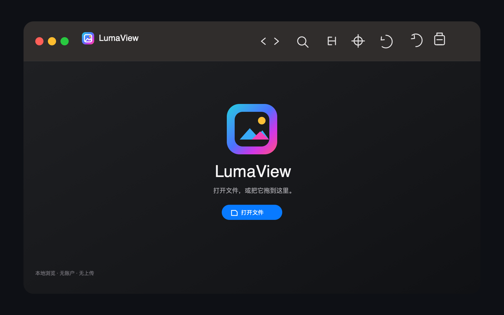
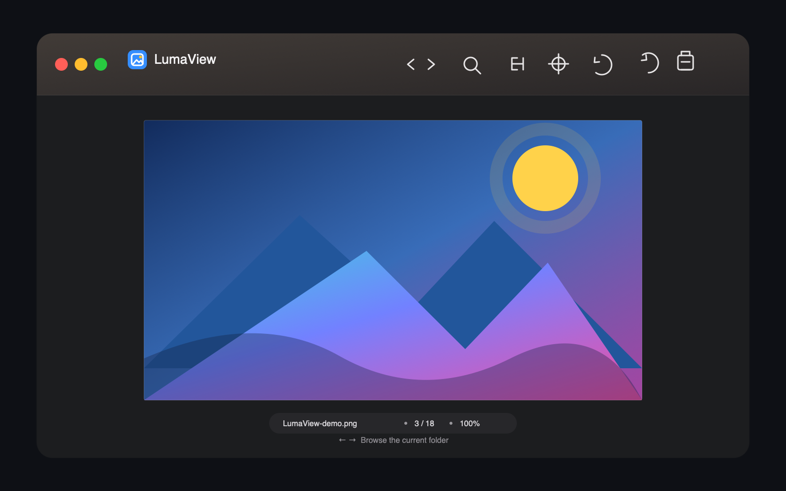

# LumaView

**軽量で使いやすい、Mac ネイティブ画像ビューア。**

画像を開いて、矢印キーで同じフォルダ内を閲覧。よく使う操作もすぐ手元に。

**LumaView 1.3.4 をダウンロード** — [Apple Silicon 版](https://github.com/ixiehao/LumaView/releases/download/v1.3.4/LumaView-1.3.4-arm64.dmg) · [Intel 版](https://github.com/ixiehao/LumaView/releases/download/v1.3.4/LumaView-1.3.4-x86_64.dmg) · [公式サイト](https://ixiehao.github.io/LumaView/ja/) · [English](README.md) · [简体中文](README.zh-CN.md) · [変更履歴](CHANGELOG.md)

macOS 12 以降 · Apple Silicon / Intel 別のインストーラ · 各約 2 MB

Apple メニュー → **「この Mac について」**で確認できます。M シリーズのチップなら Apple Silicon、Intel プロセッサなら Intel を選んでください。

## 実際の画面

| ファイルを開く | フォルダ内を閲覧 |
| --- | --- |
|  |  |

## 主な機能

- **フォルダ内を閲覧** — Finder から開く、ファイルを選ぶ、またはドラッグ＆ドロップ。`←` / `→` で前後の画像に移動できます。
- **細部を確認** — ウインドウに合わせる、拡大・縮小、パン、回転、プリント、埋め込み EXIF の表示に対応します。
- **アニメーションと PDF** — GIF とアニメーション WebP を再生。PDF は `↑` / `↓` でページをめくり、読んでいた位置を保持します。
- **画像を比較** — 複数のウインドウを開き、それぞれの拡大率と閲覧位置を保持できます。
- **Mac のために** — ネイティブ SwiftUI、7 言語、ライト・ダーク・システムの外観、標準アプリの設定に対応します。

## 対応形式

- **画像：** JPEG（`.jpg`、`.jpeg`）、PNG、HEIC / HEIF、GIF、WebP、TIFF（`.tif`、`.tiff`）、BMP、ICO、ICNS、JPEG 2000（`.jp2`、`.j2k`）。GIF とアニメーション WebP を再生できます。
- **カメラ RAW：** `.raw`、DNG、CR2、NEF、ARW、ORF、RW2 など、macOS が対応する形式。
- **書類：** 複数ページの PDF と Sketch（`.sketch`）書類の埋め込みプレビュー。
- **システム依存：** AVIF、JPEG XL（`.jxl`）など、macOS が認識する画像形式。

デコードの可否は macOS のバージョン、システムの対応状況、ファイル自体によって異なります。拡張子を認識しても、すべてのファイルを開けるとは限りません。Sketch はプレビュー表示のみで、レイヤー編集には対応しません。

## インストール

1. [Apple Silicon 版](https://github.com/ixiehao/LumaView/releases/download/v1.3.4/LumaView-1.3.4-arm64.dmg)または [Intel 版](https://github.com/ixiehao/LumaView/releases/download/v1.3.4/LumaView-1.3.4-x86_64.dmg)の DMG をダウンロードします。
2. 開いた DMG から **LumaView.app** を **アプリケーション** フォルダへドラッグします。
3. 「アプリケーション」から LumaView を開きます。画像を直接開く場合は、Finder で画像を右クリックし、「このアプリケーションで開く」→ **LumaView** を選びます。

更新時は `⌘Q` で LumaView を終了してから、アプリを置き換えてください。ウインドウを閉じるだけでは終了しません。アプリ内の「ダウンロードへ進んで終了」は、ダウンロードページを開いてから LumaView を終了します。

### 初回起動がブロックされる場合

macOS のバージョンにより、開発元を確認できない、または悪質なソフトウェアかどうか Apple で確認できない、という内容の警告が表示されることがあります。本プロジェクトの GitHub Releases または開発者が提供したテスト版から入手したことを確認したうえで、次の手順で開いてください。

1. 「アプリケーション」から **LumaView** を一度開き、上記の警告を閉じます。
2. 下表の設定を開き、**LumaView** に関するメッセージの **「このまま開く」** をクリックします。
3. 求められた場合はパスワードや Touch ID で認証し、**「開く」** を選びます。次回からは通常、ダブルクリックで起動できます。

| macOS のバージョン | 設定の場所 |
| --- | --- |
| macOS 12 Monterey | Apple メニュー → **システム環境設定 → セキュリティとプライバシー → 一般** |
| macOS 13 Ventura 以降 | Apple メニュー → **システム設定 → プライバシーとセキュリティ** → 下にスクロールして **セキュリティ** |

「このまま開く」が表示されない場合は、もう一度 LumaView を開いてから設定を確認してください。アプリの破損やコンピュータへの損害を知らせる警告には、この手順を使わず、起動を中止してプロジェクトから再ダウンロードするか、問題をご報告ください。

詳しくは [Apple の案内](https://support.apple.com/ja-jp/102445)を参照してください。

### LumaView を標準の画像ビューアにする

Finder で画像を選択 → `⌘I` → 「このアプリケーションで開く」で **LumaView** を選択 → 「すべてを変更…」をクリックします。

DMG はインストーラです。DMG を取り出しても LumaView や画像は削除されません。アンインストールする場合は、LumaView を終了してから「アプリケーション」の `LumaView.app` をゴミ箱へ移動してください。

## ショートカット

| 操作 | ショートカット |
| --- | --- |
| ファイルを開く | `⌘ O` |
| 新規ウインドウで開く | `⌘ ⇧ O` |
| PDF の前 / 次のページ | `↑` / `↓` |
| ファイル情報を常に表示 | `⌃ ⌘ I` |
| 前の画像 / 次の画像 | `←` / `→` |
| 拡大 / 縮小 | `⌘ +` / `⌘ -` |
| 画像をウインドウに合わせる | `⌘ 0` |
| 左 / 右に回転 | `⌘ [` / `⌘ ]` |
| 現在の画像をプリント | `⌘ P` |
| 現在のファイルをゴミ箱に移動 | `Delete`（初回は確認あり） |

## ソースからビルド

ビルドには[開発ガイド](docs/DEVELOPMENT.md)に記載の macOS / Xcode 環境を使用してください。ビルドしたアプリは、macOS 12 以降の Apple Silicon および Intel 搭載 Mac で動作します。

```sh
open LumaView.xcodeproj
# LumaView スキームを選び、⌘R を押します。
```

Pull Request を作成する前に、次を実行してください。

```sh
./Scripts/validate-project.sh
```

リリースのパッケージ作成、手動 QA、性能ベースラインは、[リリースガイド](docs/RELEASE.md)、[QA ガイド](docs/QA.md)、[性能ベースライン](docs/PERFORMANCE_BASELINE.md)に記載しています。

## フィードバックと貢献

問題を見つけた、またはアイデアがある場合は、構造化された[バグ報告](https://github.com/ixiehao/LumaView/issues/new?template=bug_report.yml)または[機能リクエスト](https://github.com/ixiehao/LumaView/issues/new?template=feature_request.yml)を利用してください。開発への協力については[コントリビューションガイド](CONTRIBUTING.md)、ローカルデータの取り扱いについては[プライバシー](PRIVACY.md)、脆弱性の報告については[セキュリティ](SECURITY.md)を参照してください。

LumaView は [MIT License](LICENSE) で提供しています。Tabler アイコンの帰属は [THIRD-PARTY-NOTICES.md](THIRD-PARTY-NOTICES.md) に記載しています。

## 開発・保守ドキュメント

[ドキュメント一覧](docs/README.md) · [開発と検証](docs/DEVELOPMENT.md) · [公式サイトの保守](docs/WEBSITE.md)。

公式サイトのソースは `website/` に、開発・保守ドキュメントは `docs/` に置いています。
