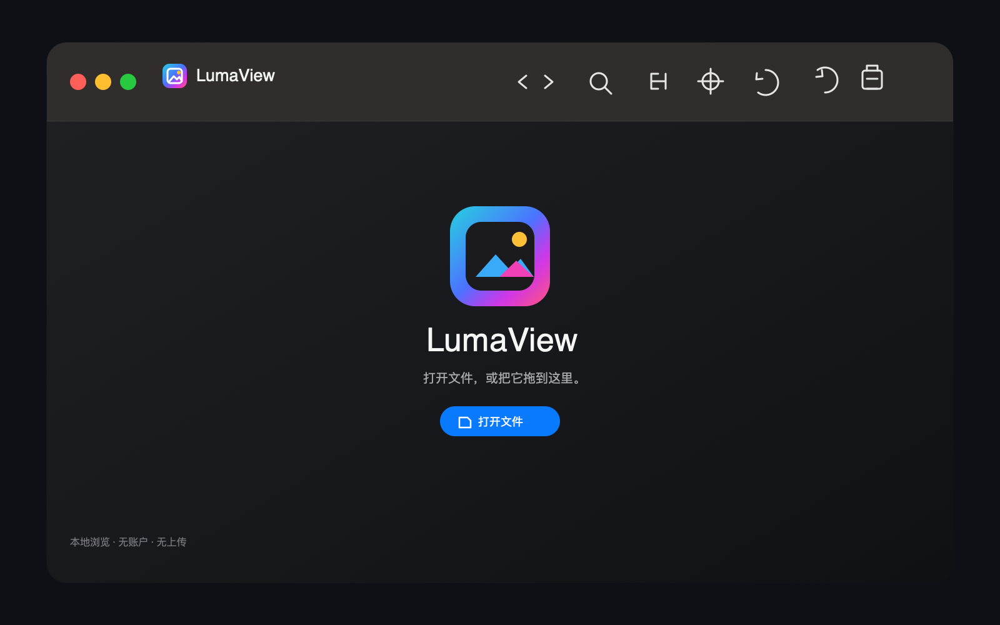
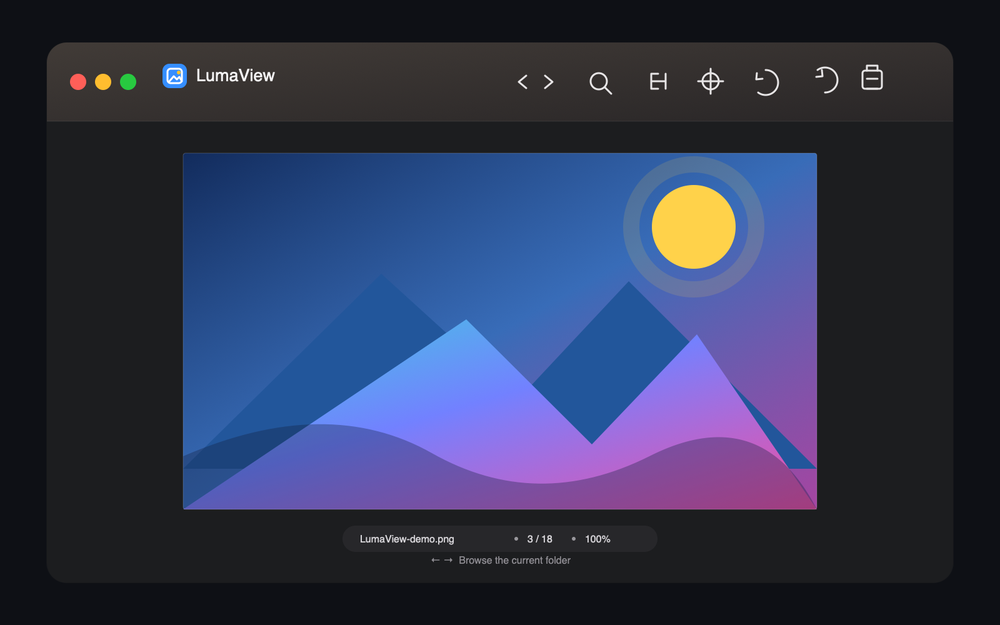

# LumaView

**A fast, minimal native image viewer for macOS.**

Open an image and browse the rest of its folder. LumaView keeps the picture in
focus, with the everyday controls close at hand.

**[Download LumaView 1.2.7 · Universal DMG](https://github.com/ixiehao/LumaView/releases/download/v1.2.7/LumaView-1.2.7-universal.dmg)** · [Website](https://ixiehao.github.io/LumaView/?lang=en) · [简体中文](README.zh-CN.md) · [日本語](README.ja.md) · [Changelog](CHANGELOG.md)

macOS 13+ · Intel + Apple Silicon · Universal DMG · ~2 MB

## LumaView in use

| Open a file | Browse its folder |
| --- | --- |
|  |  |

## Highlights

- **Browse naturally** — open from Finder, choose a file, or drag it in; use `←` / `→` or the toolbar for the previous and next image in the folder.
- **See the image clearly** — fit, zoom, pan, rotate, and print; the status bar shows the actual zoom level.
- **Inspect only when needed** — one toolbar button reveals file facts and the EXIF data embedded in the current image, without a separate folder-wide metadata scan or library.
- **Open the formats you meet every day** — JPEG, PNG, HEIC, GIF, TIFF, BMP, ICO, WebP, PDF, many macOS-supported RAW files, and `.sketch` previews.
- **Built for the Mac** — native SwiftUI, English, Simplified Chinese, and Japanese; Light / Dark / System appearance; Intel and Apple Silicon support.

## Install

1. [Download the Universal DMG](https://github.com/ixiehao/LumaView/releases/download/v1.2.7/LumaView-1.2.7-universal.dmg).
2. Open it and drag **LumaView.app** to **Applications**.
3. Open LumaView, or double-click an image and choose it from Finder's **Open With** menu.

### Make LumaView the default image viewer

In Finder, select an image → press `⌘I` → choose **LumaView** under **Open with** → click **Change All…**.

The DMG is only the installer. Removing it never removes LumaView or your images; to uninstall later, move `LumaView.app` from Applications to Trash.

## Shortcuts

| Action | Shortcut |
| --- | --- |
| Open file | `⌘ O` |
| Previous / next image | `←` / `→` |
| Zoom in / out | `⌘ +` / `⌘ -` |
| Fit image | `⌘ 0` |
| Rotate left / right | `⌘ [` / `⌘ ]` |
| Print current image | `⌘ P` |

## Build from source

Requirements: macOS 13+, Xcode 15+, and an Intel or Apple Silicon Mac.

```sh
open LumaView.xcodeproj
# Select the LumaView scheme, then press ⌘R.
```

Before opening a pull request, run:

```sh
./Scripts/validate-project.sh
```

Release packaging, manual QA, and performance baselines are documented in
[Release guide](docs/RELEASE.md), [QA guide](docs/QA.md), and
[Performance baseline](docs/PERFORMANCE_BASELINE.md).

## Feedback and contribution

Found a problem or have an idea? Use the structured [bug report](https://github.com/ixiehao/LumaView/issues/new?template=bug_report.yml) or [feature request](https://github.com/ixiehao/LumaView/issues/new?template=feature_request.yml) form. See [Contributing](CONTRIBUTING.md) for development expectations, [Privacy](PRIVACY.md) for local-data behavior, and [Security](SECURITY.md) for responsible disclosure.

LumaView is available under the [MIT License](LICENSE). Tabler icon attribution is listed in [THIRD-PARTY-NOTICES.md](THIRD-PARTY-NOTICES.md).
