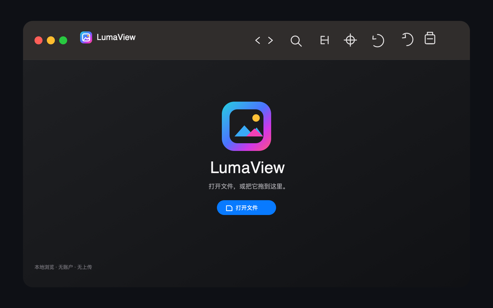
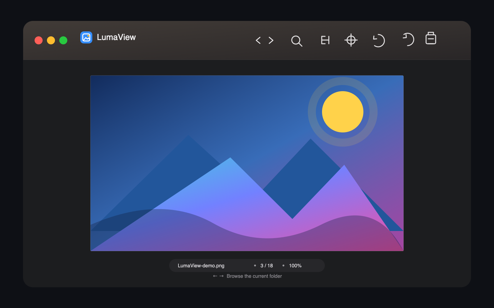

# LumaView

**A lightweight native image viewer for macOS.**

Open an image and browse its folder with the arrow keys. Everyday controls stay
close at hand.

**LumaView 1.3.5** — [Apple Silicon DMG](https://github.com/ixiehao/LumaView/releases/download/v1.3.5/LumaView-1.3.5-arm64.dmg) · [Intel DMG](https://github.com/ixiehao/LumaView/releases/download/v1.3.5/LumaView-1.3.5-x86_64.dmg) · [Website](https://ixiehao.github.io/LumaView/) · [简体中文](README.zh-CN.md) · [日本語](README.ja.md) · [Changelog](CHANGELOG.md)

macOS 12+ · Separate Apple Silicon and Intel installers · ~2 MB each

Apple menu → **About This Mac**: choose Apple Silicon for an M-series chip, or Intel for an Intel processor.

## LumaView in use

| Open a file | Browse its folder |
| --- | --- |
|  |  |

## Highlights

- **Browse folders** — open from Finder, choose a file or drag it in; use `←` / `→` for the previous and next image.
- **See the details** — fit, zoom, pan, rotate, print and inspect embedded EXIF information.
- **Play and read** — play animated GIF and WebP; use `↑` / `↓` to turn PDF pages and keep your reading position.
- **Compare images** — open separate windows, each with its own zoom and browsing position.
- **Built for the Mac** — native SwiftUI, seven languages, Light / Dark / System appearance, and default-app settings.

## Supported formats

- **Images:** JPEG (`.jpg`, `.jpeg`), PNG, HEIC / HEIF, GIF, WebP, TIFF (`.tif`, `.tiff`), BMP, ICO, ICNS and JPEG 2000 (`.jp2`, `.j2k`). Animated GIF and WebP can play.
- **Camera RAW:** `.raw`, DNG, CR2, NEF, ARW, ORF, RW2 and other formats supported by macOS.
- **Documents:** multi-page PDF and the embedded preview of a Sketch (`.sketch`) document.
- **System-dependent:** AVIF and JPEG XL (`.jxl`), as well as other image formats recognized by macOS.

Decoding depends on the macOS version, installed codecs and the individual file. Recognizing a file extension does not guarantee that every file can be opened. Sketch displays its preview, not editable layers.

## Install

1. Download the DMG for [Apple Silicon](https://github.com/ixiehao/LumaView/releases/download/v1.3.5/LumaView-1.3.5-arm64.dmg) or [Intel](https://github.com/ixiehao/LumaView/releases/download/v1.3.5/LumaView-1.3.5-x86_64.dmg).
2. Open it and drag **LumaView.app** to **Applications**.
3. Open LumaView from Applications. To open an image directly, Control-click it in Finder and choose **Open With → LumaView**.

When upgrading, quit LumaView with `⌘Q` before replacing the app. Closing its windows does not quit it. The in-app **Go to Download and Quit** action opens the download page and then quits LumaView.

### If macOS blocks the first launch

Messages vary by macOS version: the developer may be unverified, or Apple may be unable to check the app for malicious software. If you trust the copy downloaded from this project's GitHub Releases or supplied by the developer for testing:

1. Try opening **LumaView** from Applications once, then dismiss that alert.
2. Follow the settings path below, find the message about **LumaView**, and click **Open Anyway**.
3. Authenticate if prompted, then confirm **Open**. Subsequent launches normally work by double-clicking.

| macOS version | Settings path |
| --- | --- |
| macOS 12 Monterey | Apple menu → **System Preferences → Security & Privacy → General** |
| macOS 13 Ventura or later | Apple menu → **System Settings → Privacy & Security**, then scroll to **Security** |

If **Open Anyway** is missing, try opening LumaView again, then return to settings. A damaged-app or malware warning is different: stop and download a fresh copy from the project or report the issue instead of overriding it.

See [Apple's opening instructions](https://support.apple.com/en-us/102445).

### Make LumaView the default image viewer

In Finder, select an image → press `⌘I` → choose **LumaView** under **Open with** → click **Change All…**.

The DMG is only the installer. Removing it never removes LumaView or your images; to uninstall later, move `LumaView.app` from Applications to Trash.

## Shortcuts

| Action | Shortcut |
| --- | --- |
| Open file | `⌘ O` |
| Open files in new windows | `⌘ ⇧ O` |
| Previous / next PDF page | `↑` / `↓` |
| Keep file information visible | `⌃ ⌘ I` |
| Previous / next image | `←` / `→` |
| Zoom in / out | `⌘ +` / `⌘ -` |
| Fit image | `⌘ 0` |
| Rotate left / right | `⌘ [` / `⌘ ]` |
| Print current image | `⌘ P` |
| Move current file to Trash | `Delete` (confirmation on first use) |

## Build from source

Use the macOS/Xcode toolchain described in the [development guide](docs/DEVELOPMENT.md). The built app runs on macOS 12 or later, on both Apple Silicon and Intel Macs.

```sh
open LumaView.xcodeproj
# Select the LumaView scheme, then press ⌘R.
```

Before opening a pull request, run:

```sh
./Scripts/validate-project.sh
```

Release packaging, manual QA, and performance baselines are documented in
[Release guide](docs/RELEASE.md), [QA guide](docs/QA.md), and
[Performance baseline](docs/PERFORMANCE_BASELINE.md).

## Feedback and contribution

Found a problem or have an idea? Use the structured [bug report](https://github.com/ixiehao/LumaView/issues/new?template=bug_report.yml) or [feature request](https://github.com/ixiehao/LumaView/issues/new?template=feature_request.yml) form. See [Contributing](CONTRIBUTING.md) for development expectations, [Privacy](PRIVACY.md) for local-data behavior, and [Security](SECURITY.md) for responsible disclosure.

LumaView is available under the [MIT License](LICENSE). Tabler icon attribution is listed in [THIRD-PARTY-NOTICES.md](THIRD-PARTY-NOTICES.md).

## Development documentation

[Documentation index](docs/README.md) · [Development and validation](docs/DEVELOPMENT.md) · [Website maintenance](docs/WEBSITE.md).

The official website source lives in `website/`; `docs/` is reserved for maintainer documentation.
