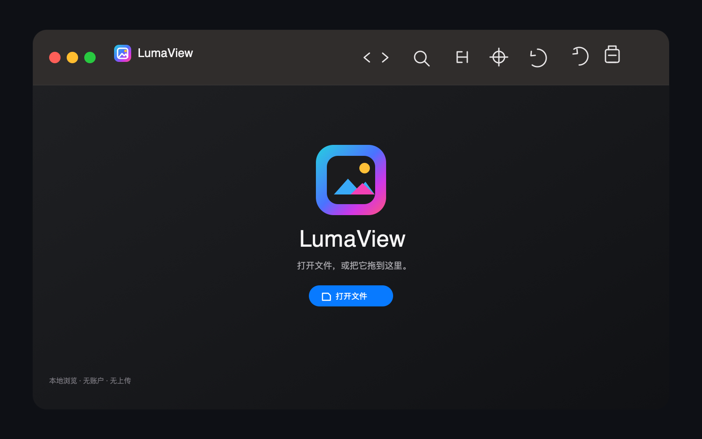
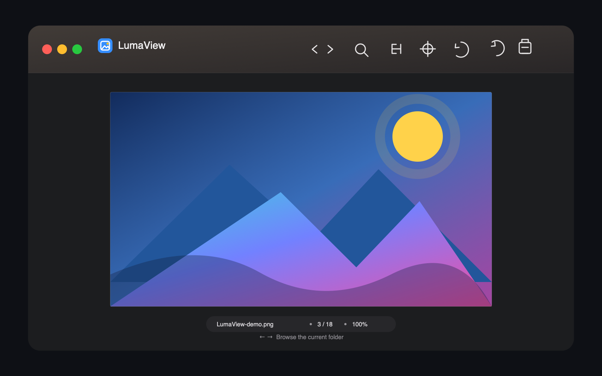

# LumaView

**一款轻巧、便捷的 Mac 原生看图软件。**

打开一张图片，用方向键浏览同一文件夹，常用操作顺手就能找到。

**下载 LumaView 1.3.4** — [Apple Silicon 版](https://github.com/ixiehao/LumaView/releases/download/v1.3.4/LumaView-1.3.4-arm64.dmg) · [Intel 版](https://github.com/ixiehao/LumaView/releases/download/v1.3.4/LumaView-1.3.4-x86_64.dmg) · [官网](https://ixiehao.github.io/LumaView/zh/) · [English](README.md) · [日本語](README.ja.md) · [变更记录](CHANGELOG.md)

macOS 12+ · Apple Silicon / Intel 独立安装包 · 每个约 2 MB

苹果菜单 → **关于本机**：M 系列芯片选 Apple Silicon，Intel 处理器选 Intel。

## 软件实机截图

| 打开文件 | 浏览文件夹 |
| --- | --- |
|  |  |

## 功能

- **浏览文件夹** — 从访达打开、选择文件或直接拖入，用 `←` / `→` 查看上一张、下一张。
- **查看细节** — 适合窗口、缩放、平移、旋转、打印，以及查看内嵌 EXIF 信息。
- **播放与阅读** — 播放 GIF 和动态 WebP；用 `↑` / `↓` 翻阅 PDF，保留阅读进度。
- **多图对比** — 每张图片独立成窗，各自保留缩放与浏览位置。
- **原生体验** — SwiftUI 界面、七种语言、浅色 / 深色 / 跟随系统，并可设置默认打开格式。

## 支持的格式

- **图片：** JPEG（`.jpg`、`.jpeg`）、PNG、HEIC / HEIF、GIF、WebP、TIFF（`.tif`、`.tiff`）、BMP、ICO、ICNS、JPEG 2000（`.jp2`、`.j2k`）；支持播放 GIF 和动态 WebP。
- **相机 RAW：** `.raw`、DNG、CR2、NEF、ARW、ORF、RW2 等 macOS 支持的格式。
- **文档：** 多页 PDF；Sketch（`.sketch`）文档内嵌预览。
- **取决于系统：** AVIF、JPEG XL（`.jxl`）以及 macOS 识别的其他图片格式。

能否解码取决于 macOS 版本、系统解码能力和文件本身；识别扩展名不代表所有文件都能打开。Sketch 显示的是预览，不能编辑图层。

## 安装

1. 下载对应的 [Apple Silicon 版](https://github.com/ixiehao/LumaView/releases/download/v1.3.4/LumaView-1.3.4-arm64.dmg)或 [Intel 版](https://github.com/ixiehao/LumaView/releases/download/v1.3.4/LumaView-1.3.4-x86_64.dmg) DMG。
2. 打开它，将 **LumaView.app** 拖进“应用程序”。
3. 从“应用程序”打开 LumaView；也可在访达中右键图片，选择“打开方式” → **LumaView**。

### 首次打开被系统拦截时

不同 macOS 版本的提示可能不同，例如“无法验证开发者”或“Apple 无法检查其是否包含恶意软件”。确认安装包来自本项目的 GitHub Releases 或开发者提供的测试包后，可以按以下步骤打开：

1. 从“应用程序”打开一次 **LumaView**，出现上述提示后关闭提示框。
2. 按下表进入系统安全设置，找到 **LumaView** 的拦截提示，点按 **“仍要打开”**（Open Anyway）。
3. 根据系统提示使用密码或触控 ID 确认，再选择 **“打开”**。以后通常可以直接双击启动。

| 系统版本 | 设置入口 |
| --- | --- |
| macOS 12 Monterey | 苹果菜单 → **系统偏好设置** → **安全性与隐私** → **通用** |
| macOS 13 Ventura 及更新版本 | 苹果菜单 → **系统设置** → **隐私与安全性**（部分版本称“隐私与安全”）→ 向下找到 **安全性** |

如果没有看到“仍要打开”，先再次尝试打开 LumaView，再返回设置查看。若提示“已损坏”或“会损坏你的电脑”，请停止打开，重新从项目页面下载或反馈问题，不按上述流程放行。

参见 Apple 的 [Monterey 打开说明](https://support.apple.com/zh-cn/guide/mac-help/mh40616/12.0/mac/12.0)和[新版 macOS 打开说明](https://support.apple.com/zh-cn/102445)。

### 设为默认看图软件

在访达中选中一张图片 → 按 `⌘I` → 在“打开方式”中选择 **LumaView** → 点按“全部更改…”。

DMG 只是安装包。删除它不会删除 LumaView 或任何图片；如需卸载，只需退出应用，再将“应用程序”中的 `LumaView.app` 移入废纸篓。

## 快捷键

| 操作 | 快捷键 |
| --- | --- |
| 打开文件 | `⌘ O` |
| 在新窗口中打开文件 | `⌘ ⇧ O` |
| PDF 上一页 / 下一页 | `↑` / `↓` |
| 始终显示文件信息 | `⌃ ⌘ I` |
| 上一张 / 下一张 | `←` / `→` |
| 放大 / 缩小 | `⌘ +` / `⌘ -` |
| 适合窗口 | `⌘ 0` |
| 向左 / 向右旋转 | `⌘ [` / `⌘ ]` |
| 打印当前图片 | `⌘ P` |
| 将当前文件移到废纸篓 | `Delete`（首次使用会提示） |

## 从源码构建

构建环境请参考[开发说明](docs/DEVELOPMENT.md)中的 macOS / Xcode 工具链。编译后的应用支持 macOS 12 及以上，以及 Apple Silicon 和 Intel Mac。

```sh
open LumaView.xcodeproj
# 选择 LumaView scheme，再按 ⌘R。
```

提交 Pull Request 前请运行：

```sh
./Scripts/validate-project.sh
```

发版打包、人工验收和性能基线分别见[发布说明](docs/RELEASE.md)、[QA 说明](docs/QA.md)和[性能基线](docs/PERFORMANCE_BASELINE.md)。

## 反馈与贡献

遇到问题或有功能想法？请使用结构化的[问题反馈](https://github.com/ixiehao/LumaView/issues/new?template=bug_report.yml)或[功能建议](https://github.com/ixiehao/LumaView/issues/new?template=feature_request.yml)。开发协作请阅读[贡献说明](CONTRIBUTING.md)；本地数据行为见[隐私说明](PRIVACY.md)，安全问题请参考[安全说明](SECURITY.md)。

LumaView 使用 [MIT License](LICENSE)。Tabler 图标归属见 [THIRD-PARTY-NOTICES.md](THIRD-PARTY-NOTICES.md)。

## 开发与维护文档

[文档索引](docs/README.md) · [开发与验证](docs/DEVELOPMENT.md) · [官网维护](docs/WEBSITE.md)。

官网源码统一位于 `website/`，`docs/` 用于开发与维护文档。
